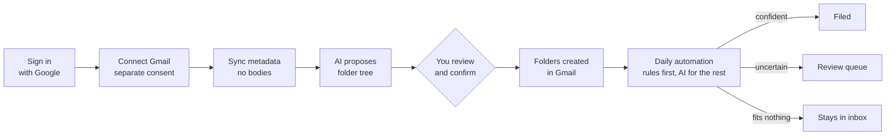
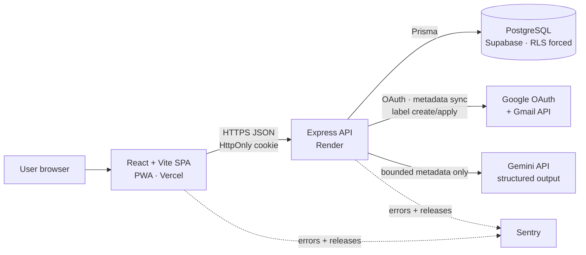
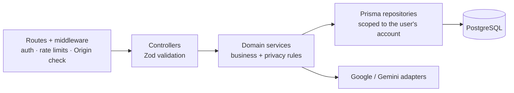
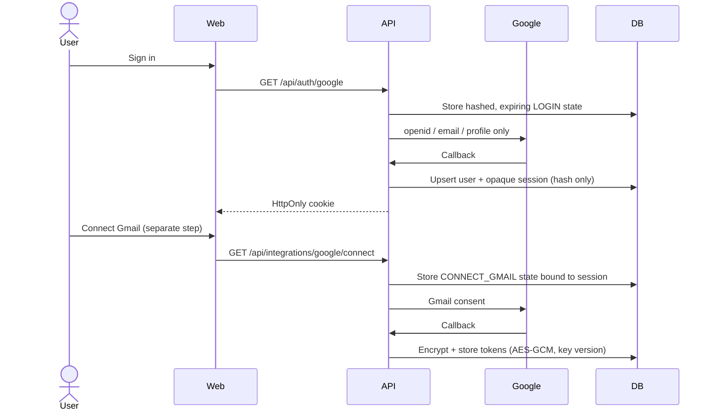

<div align="center">

# MailMind AI

**AI that organises your Gmail into folders you approve, without ever reading or storing your email bodies.**

[Live app](https://mailmindai.tech) · [Architecture](#architecture) · [Security and privacy](#security-and-privacy) · [Getting started](#getting-started) · [API reference](docs/api.md)


</div>

---

## Table of contents

1. [Problem](#problem)
2. [Solution](#solution)
3. [Features](#features)
4. [How it works](#how-it-works)
5. [Architecture](#architecture)
6. [Security and privacy](#security-and-privacy)
7. [Reliability and cost control](#reliability-and-cost-control)
8. [Tech stack](#tech-stack)
9. [Testing and CI](#testing-and-ci)
10. [Getting started](#getting-started)
11. [Project structure](#project-structure)
12. [Documentation](#documentation)
13. [Limitations and roadmap](#limitations-and-roadmap)

---

## Problem

Inboxes grow faster than anyone can sort them. The tools people turn to fail in one of three ways:

- **Manual filters don't scale.** Gmail filters match a sender or a keyword, so you need one rule per pattern and they break as soon as a sender changes how they write.
- **"AI inbox" tools ask for too much.** Most read and store the full content of every email on their own servers, which is a lot of trust to hand over for tidier folders.
- **Automatic sorting is a black box.** When a tool invents its own categories and moves mail without asking, you stop trusting it the first time something important disappears.

## Solution

MailMind is a **human-in-the-loop** organiser that is private by design:

1. **It proposes folders from your own mail.** One AI planning pass looks at a sample of your mail's metadata (sender, subject, snippet) and designs a folder tree that Gmail search can't already give you.
2. **You approve it.** You rename, delete or add folders and confirm the set once. **Nothing is created in Gmail before you confirm.**
3. **It files daily, within your set.** Every message goes into exactly one approved folder. Free rules handle what they can, and AI handles only the rest. Anything that fits no folder **stays in your inbox**, because MailMind never invents a folder on its own.

And throughout: **no email body, raw message or attachment is ever downloaded or stored.**

## Features

| Feature                               | What it does                                                                             | How it works                                                                                                                                                                                                                                                                                                                                                               |
| ------------------------------------- | ---------------------------------------------------------------------------------------- | -------------------------------------------------------------------------------------------------------------------------------------------------------------------------------------------------------------------------------------------------------------------------------------------------------------------------------------------------------------------------- |
| **Separate sign-in and Gmail access** | Signing in does **not** grant Gmail access. Connecting Gmail is a second, explicit step. | Two separate Google OAuth flows with purpose-bound, single-use, hashed and expiring state plus PKCE. Google tokens are encrypted (AES-GCM, with a key version) before storage.                                                                                                                                                                                             |
| **Metadata-only sync**                | Brings in what's needed to organise mail and nothing more                                | Requests Gmail's `metadata` format only: IDs, selected headers, a truncated snippet, labels, dates and attachment _presence_. Initial sync is bounded, and incremental sync follows Gmail history IDs from a stored checkpoint.                                                                                                                                            |
| **AI folder proposal**                | Designs a folder tree from your own mail                                                 | Takes a stratified sample of up to 500 messages and makes **one** Gemini call with structured output. The model's answer is treated as untrusted: code enforces a maximum depth of 3, at most 40 folders, minimum mail per folder, naming rules, and evidence that each folder's subject pattern really appears in the sample. Folders that fail are dropped and reported. |
| **Approval as a contract**            | You review the tree, with counts, before anything happens                                | `POST /api/labels/confirm` stores the approved tree and its routing rules. Only leaf folders are created in Gmail, and only after confirmation. Deleting a folder in MailMind never deletes your mail.                                                                                                                                                                     |
| **Daily automation**                  | Files new mail every day                                                                 | Rules from the approved plan run first and cost nothing. Rules learned from applied mail are reused only after repeated, consistent successes. Only unmatched mail goes to Gemini, in bounded batches. Confident results are applied, and uncertain ones go to a **review queue**.                                                                                         |
| **Facets and pivot views**            | The same mail, arranged several ways                                                     | Each message gets three independent facets (**entity**, **domain**, **intent**), and a folder tree is just one _ordering_ of them. `Netflix › Payment failed` and `Finance › Payment failed › Netflix` are two views of the same mail. Switching costs no reclassification and no API call, and the view is shareable as a URL.                                            |
| **Find and favourites**               | Search the whole tree and star the folders you use                                       | Search covers subject and sender across the mailbox. Stars update instantly and roll back if the server refuses. Folder colours come from a hash of the path, so a folder keeps its colour between sessions.                                                                                                                                                               |
| **Notifications**                     | New-mail alerts, in the app and on the device                                            | One shared query feeds the badge, the feed and in-app toasts. Device alerts use **Web Push** (VAPID) through a service worker, and logging out unsubscribes the device.                                                                                                                                                                                                    |
| **Activity log**                      | Full transparency over what ran                                                          | Every run records its state, progress, tokens, estimated cost, stop reason and safe error codes, and every filing records the chosen folder and the evidence for it.                                                                                                                                                                                                       |
| **Installable PWA**                   | Works like a native app                                                                  | Manifest, icons, a service worker that never caches API responses, and an instant start that shows cached folder names while a sleeping server wakes up (no subjects or senders are cached).                                                                                                                                                                               |
| **Account control**                   | Disconnect or delete at any time                                                         | Disconnecting revokes Google credentials and wipes the token material. Account deletion cascades through all of the account's data.                                                                                                                                                                                                                                        |

## How it works



## Architecture

A **TypeScript monorepo** with a static React frontend and one stateless Express API backed by PostgreSQL. Only the API crosses the trust boundaries to Postgres, Google and Gemini. The browser never sees an OAuth token or a service credential.



### API layering



### Sign-in vs Gmail connection



### Data model (28 Prisma models, 27 migrations)

| Group                 | Tables                                                                                                                         |
| --------------------- | ------------------------------------------------------------------------------------------------------------------------------ |
| Identity and security | `users`, `sessions`, `oauth_states`, `audit_logs`                                                                              |
| Google connection     | `connected_google_accounts`                                                                                                    |
| Gmail projection      | `gmail_labels`, `gmail_message_metadata`, `gmail_sync_states`, `gmail_sync_runs`                                               |
| Labels                | `user_labels`, `taxonomy_plans`, `taxonomy_plan_nodes`, `taxonomy_plan_node_rules`                                             |
| Automation            | `automation_settings`, `automation_states`, `automation_runs`, `automation_message_actions`, `learned_classification_patterns` |
| Facets                | `message_facets`, `facet_pivot_settings`                                                                                       |

## Security and privacy

| Control                    | Implementation                                                                                                                                            |
| -------------------------- | --------------------------------------------------------------------------------------------------------------------------------------------------------- |
| Least data                 | Metadata only. No bodies, raw MIME or attachments are fetched or stored                                                                                   |
| Least privilege (database) | **RLS enabled and forced** on application tables. `PUBLIC`, `anon` and `authenticated` have no table privileges, and the API uses a dedicated Prisma role |
| Token protection           | Google tokens encrypted with AES-GCM and key versioning. Sessions are random opaque tokens and only their hashes are stored                               |
| OAuth hardening            | PKCE, single-use purpose-bound state, safe redirect paths, separate callbacks                                                                             |
| CSRF                       | Exact-origin CORS with credentials (no wildcard) and trusted-Origin checks on every cookie-authenticated write                                            |
| Cookies                    | HttpOnly, Secure in production, matching attributes on set and clear                                                                                      |
| Browser hardening          | Strict Content-Security-Policy with a script hash, HSTS, `frame-ancestors 'none'`, Helmet headers                                                         |
| Abuse limits               | 1 MiB request cap, rate limits per endpoint, request IDs                                                                                                  |
| Logging                    | Structured Pino logs with secrets redacted, and generic 500 responses                                                                                     |
| AI safety                  | Model output is never trusted. Every structural rule is re-checked in code after parsing                                                                  |

## Reliability and cost control

- **No overlapping work.** Sync, planning and automation each take an expiring database **lease** per account, so several API instances can share one database safely.
- **Idempotent by construction.** Scheduled runs are keyed by account and date, and message actions are unique, so a retried run never files a message twice.
- **Resumable.** Sync commits a Gmail history checkpoint, and facet classification uses each stored row as its checkpoint, so a run stopped by quota continues where it left off.
- **Durable partial progress.** External calls happen outside database transactions, so work that has finished survives a failure part-way through.
- **Hard budget caps.** Limits on messages, input tokens, output tokens and estimated cost (in micro-USD) per run. Hitting one ends the run as `PARTIAL` with `DAILY_BUDGET_REACHED`, and completed work is kept.
- **Free rules first.** Plan rules and proven learned patterns are tried before any model call, so AI cost falls as the system learns.
- **Health probes.** `/health` (liveness, no database) and `/ready` (a database query with a 5-second timeout). The API connects Prisma before listening and shuts down gracefully.
- **Fast on a free plan.** The SPA renders cached folder names immediately and retries while the sleeping API wakes up.

## Tech stack

| Layer         | Technology                                                                                      |
| ------------- | ----------------------------------------------------------------------------------------------- |
| Frontend      | React, Vite, TypeScript, TanStack Query, React Router, Tailwind CSS, PWA with Web Push          |
| Backend       | Node.js 22, Express, TypeScript (ESM), Zod, Prisma, Pino, Helmet, express-rate-limit            |
| Database      | PostgreSQL on Supabase (forced RLS, dedicated role)                                             |
| Integrations  | Google OAuth 2.0 + Gmail API (`googleapis`), Google Gemini (Flash-Lite, structured JSON output) |
| Observability | Sentry (web + API, release-tagged)                                                              |
| Testing       | Vitest, Testing Library, Supertest, Playwright (end-to-end)                                     |
| CI/CD         | GitHub Actions · Vercel (web) · Render (API)                                                    |
| Tooling       | npm workspaces, ESLint, Prettier, shared TS configs                                             |

## Testing and CI

- **850+ test cases across 92 test files**: unit, API (Supertest), database integration, and frontend component tests, plus **Playwright** end-to-end tests.
- Every push and pull request runs in **GitHub Actions**:
  1. Production dependency audit (with a dated, reasoned allowlist)
  2. A **disposable PostgreSQL 16** service with the real migrations applied
  3. Backend, database-integration and frontend tests
  4. Typecheck, lint and format checks
  5. Production builds, then **probes against the built API**
- CI never uses production Supabase credentials and never calls Google.

```bash
npm test            # backend + frontend tests
npm run typecheck   # all workspaces
npm run lint
npm run build
```

## Getting started

**Prerequisites:** Node.js 22+, npm 10+, Docker Desktop, Supabase CLI 2.x, a Google Cloud OAuth client, a Gemini API key.

```powershell
git clone https://github.com/Asongwelewis/AI-email-organizer-for-gmail.git
cd AI-email-organizer-for-gmail
npm install
Copy-Item .env.example .env
Copy-Item apps/api/.env.example apps/api/.env
Copy-Item apps/web/.env.example apps/web/.env
supabase start        # local database (disposable)
npm run dev           # web + API
```

For Supabase roles and pooler setup, Prisma migrations, Google OAuth configuration and deployment, see [Stage 2 setup](docs/stage-2-setup.md) and [MVP deployment](docs/mvp-deployment.md).

> `supabase db reset` is destructive and is only for the disposable local stack, never a remote project.

## Project structure

```
apps/
  web/        React + Vite SPA (pages, queries, PWA, push)
  api/        Express API (routes → controllers → services → repositories), Prisma schema + migrations
packages/
  shared/     shared types, constants, utilities
  ui/         shared React UI primitives
  config/     shared ESLint, Prettier and TypeScript config
supabase/     ordered SQL migrations for Supabase
e2e/          Playwright end-to-end tests
docs/         architecture, API, backend, frontend, stage guides
```

## Documentation

| Document                                                        | Covers                                                                 |
| --------------------------------------------------------------- | ---------------------------------------------------------------------- |
| [Architecture](docs/architecture.md)                            | Trust boundaries, flows, data model, security architecture, trade-offs |
| [API reference](docs/api.md)                                    | Every endpoint, request and response                                   |
| [Backend](docs/backend.md) · [Frontend](docs/frontend.md)       | Implementation details                                                 |
| [Gmail sync](docs/stage-3-gmail-sync.md)                        | Metadata boundary, checkpoints, retries                                |
| [Daily automation](docs/stage-5-daily-automation.md)            | Scheduling, budgets, Gemini and Gmail boundaries                       |
| [Deployment](docs/mvp-deployment.md) · [Sentry](docs/sentry.md) | Release and monitoring                                                 |

## Limitations and roadmap

- **In-process scheduler.** Daily automation runs on a poller inside the API. Next: move the same lease-protected service behind a durable queue. Message idempotency already makes that a drop-in change.
- **Free-tier hosting.** The API sleeps when idle. The SPA hides most of the wake time, but the first action after idle is slower.
- **Gmail verification.** Wider release needs Google's OAuth verification for the Gmail scope.
- **Single frontend origin.** CORS and CSRF use one shared allowlist, so a new frontend means updating configuration.

## Author

Built by **Asongwe Lewis Fon** ([@Asongwelewis](https://github.com/Asongwelewis)), full-stack engineer, Yaoundé, Cameroon. Open to remote and relocation roles.
